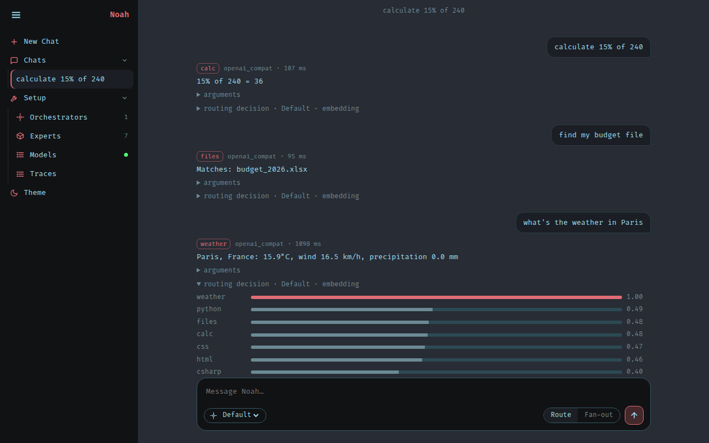
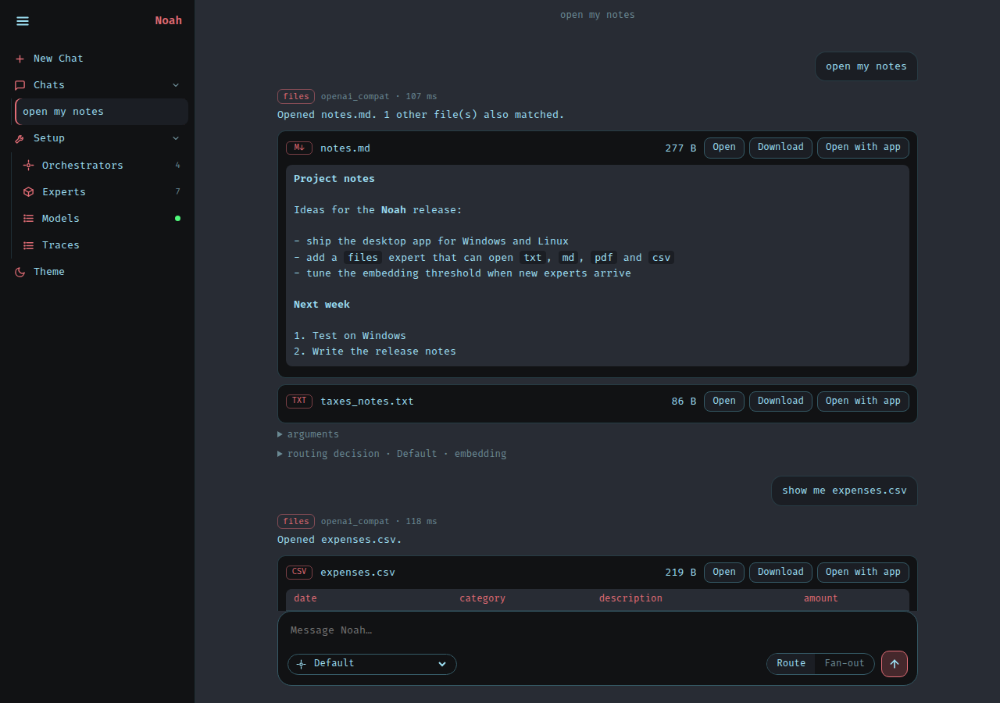
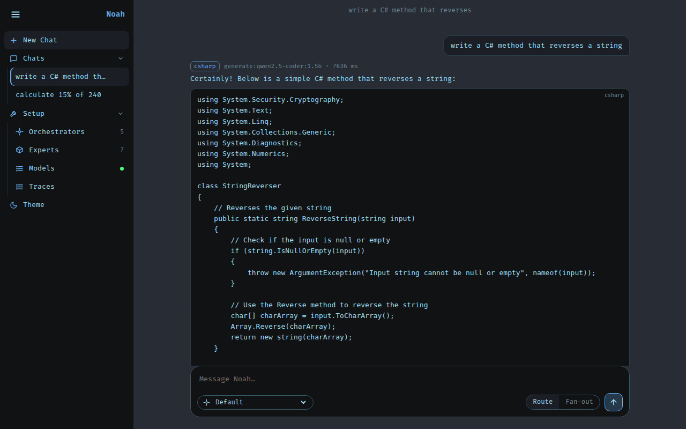
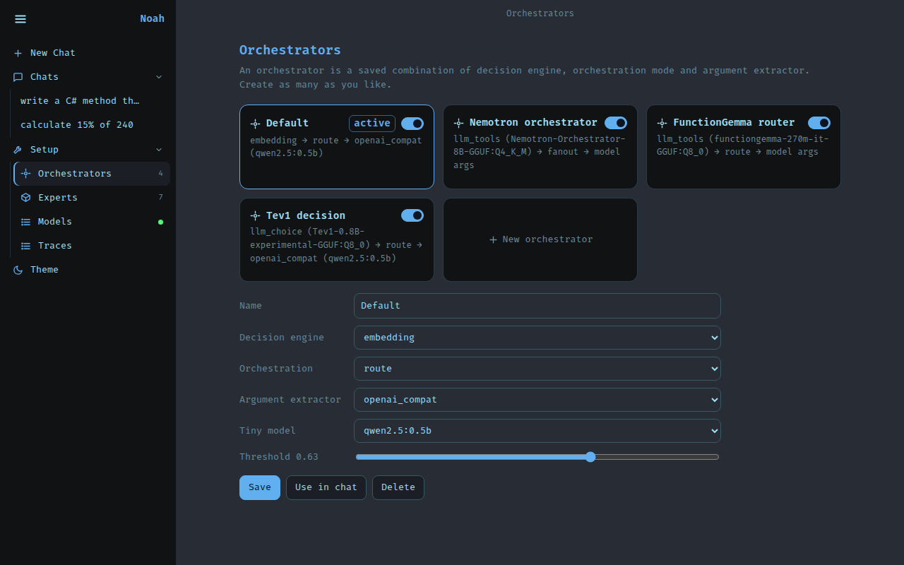

# Noah

Layered tiny-model orchestration. You pick a **decision engine** and an **orchestrator**; each job goes to a
small **expert** (a tiny model, a tool, or both). Every decision is traced, so you can later fine-tune your own.

```
message -> [decision engine] -> [orchestrator: Microsoft Agent Framework workflow] -> [expert(s)] -> answer
                                                                                         \-> trace (JSONL)
```

## Screenshots

Each message is routed to one tiny expert; open "routing decision" to see how every expert scored.



A generate expert (C#, Qwen2.5-Coder 1.5B) answers with code. Orchestrator profiles (decision engine + mode + extractor + model) are managed in the UI.

Files expert: open a file right in the chat, or get download / open-with-app options.



| Code expert | Orchestrator profiles |
|---|---|
|  |  |

Regenerate them against a running server with `python scripts/readme_shots.py` (needs `pip install -e ".[dev]"` plus `playwright install chromium`, or `CHROMIUM=/path/to/chromium`).

## Quick start (Docker or Podman)

```bash
make up            # builds the image, starts Ollama, pulls the tiny models, starts Noah
# open http://localhost:8765
```

`make` auto-detects Docker or Podman. First start downloads about 1.5 GB of models; later starts are instant.

| You use | Needs |
|---|---|
| Docker | Docker with the Compose plugin (`docker compose`) |
| Podman | Podman 4+ and a compose provider: `pip install podman-compose` or `docker-compose` |

Without `make`:

```bash
docker compose up --build                       # Docker
PODMAN_USERNS=keep-id podman compose up --build # Podman (rootless: keep-id makes bind mounts writable)
```

NVIDIA GPU for Ollama: `make up GPU=1` (Podman also needs the CDI spec: `nvidia-ctk cdi generate`).

Windows (Podman Desktop / `podman machine`): there is no `make`, so use `podman compose up --build`. Run
`podman machine start` first. The WSL machine is rootful, so leave out `PODMAN_USERNS=keep-id`. If the build fails at
`pip install` with "Network is unreachable", or models time out on "pulling manifest", the machine's container
networking is broken. Try `podman machine stop` then `podman machine start`. If that doesn't help, build with
`podman build --network=host -t noah_noah .` and run both containers with `--network=host` (Noah with
`-e NOAH_LLM_URL=http://localhost:11434`).

Code, `experts/`, `data/` and `traces/` are bind-mounted, so edits reload live and traces survive restarts.
Ollama is not published to the host, so a host Ollama on port 11434 keeps working.

Other targets: `make test` (tests inside the image), `make logs`, `make shell`, `make down`,
`make pull-models M=qwen2.5-coder:3b`. Change the default models with `NOAH_MODELS="a b" make up`.

## Desktop app (Electron)

The desktop app is an extra shell around the same server and web UI. The browser UI (`make up`, `uvicorn`) is unchanged
and stays fully supported. The shell starts the server on a random loopback port with a per-launch secret (HttpOnly
cookie + Host check, so other web pages can't call it), shows the UI in a locked-down window, and stops the server on exit.

```bash
cd desktop && npm install
npm start                          # dev: uses ../.venv (or NOAH_PYTHON); needs the Python deps installed
python ../desktop/build_sidecar.py # freeze the server with PyInstaller (run in the project venv, ~170 MB)
npm run dist                       # installer in desktop/dist/ (AppImage on Linux, NSIS .exe on Windows, .dmg on macOS)
```

- PyInstaller and Electron don't cross-compile. `.github/workflows/desktop.yml` builds all three OSes on real runners
  (Actions tab > "Desktop builds" > Run workflow); download the installers from the run's Artifacts.
- Installed apps keep editable experts, profiles, traces and models in the OS user-data folder
  (Linux: `~/.config/noah-desktop`, Windows: `%APPDATA%\noah-desktop`), seeded on first run. The first embedding-engine use downloads about 70 MB.
- Builds are unsigned: expect a Windows SmartScreen or macOS Gatekeeper warning.
- Linux on Wayland + NVIDIA: Electron's native Wayland path crashed here, so Linux starts in X11 mode. Opt out with
  `NOAH_OZONE_PLATFORM=wayland`.
- Ollama is not bundled. The app tells you if it can't find it on port 11434.
- Windows: run the build from the project venv (`.venv\Scripts\activate`, then `pip install -e . pyinstaller`).
  PyInstaller warns that it can't collect `onnxruntime.quantization`; this is harmless. VS Code's terminal sets
  `ELECTRON_RUN_AS_NODE=1`, so starting `dist\win-unpacked\Noah.exe` from it fails with "bad option". Use
  `npm start` (it clears the variable), launch the app from Explorer, or run `Remove-Item Env:ELECTRON_RUN_AS_NODE` first.

With containers, `make dev` adds `compose.dev.yaml`: it mounts `noah/` and `experts/`, reloads the server on every Python/YAML change, and runs the Vite dev server for the UI (see "Web UI development" below).

## Without containers

```bash
python3 -m venv .venv && . .venv/bin/activate    # Windows: python -m venv .venv; .venv\Scripts\activate
pip install -e ".[dev]"
ollama serve &                                   # any OpenAI-compatible server works
ollama pull qwen2.5:0.5b && ollama pull qwen2.5-coder:1.5b
(cd frontend && npm install && npm run build)     # build the web UI once (Node 20+); the server serves noah/web/dist
uvicorn noah.server:app --port 8765              # NOAH_LLM_URL=http://host:port to point elsewhere
# while developing, reload on any Python/YAML change:
uvicorn noah.server:app --port 8765 --reload --reload-include "*.yaml"
pytest
python -m noah.cli ask "calculate 15% of 240" --engine embedding
```

### Web UI development (Vue + Vite, hot reload)

The UI is a Vue 3 app in `frontend/` (single-file components in `src/components/`, all shared state in `src/store.js`).
Vite serves it with hot module reload and proxies `/api` to the Noah server:

```bash
make dev                                # containers: API with reload + Vite, UI at http://localhost:5173
make dev-host                           # no containers (Linux/macOS): both on the host, same URLs
# or by hand, in two terminals (Windows too):
uvicorn noah.server:app --port 8765 --reload --reload-include "*.yaml"    # the API
cd frontend && npm install && npm run dev                                 # Vite: http://localhost:5173
```

Work at **http://localhost:5173** (Vite). Port 8765 serves the last production build, so it will not show your edits.

Edit a `.vue` file or `app.css` and the page updates in place without losing what you typed or the page you are on.
`make ui-build` (or `cd frontend && npm run build`) writes the production UI to `noah/web/dist`, which the server, the
Docker image (built in a Node stage, no Node at runtime) and the desktop app (`build_sidecar.py` runs it) all serve.
`noah/web/dist` is not committed, so a source checkout needs that one build, or the server shows a page saying so.
Another API port: `NOAH_API=http://127.0.0.1:9000 npm run dev`.

## Slots

| Slot | Choices today | Add your own |
|---|---|---|
| Decision engine | `keyword`, `embedding`, `llm_tools`, `llm_choice`, `laya` (optional) | implement `DecisionEngine` in `noah/engines/` |
| Orchestrator | `route` (best expert), `fanout` (several) | `noah/orchestrator.py` |
| Argument extractor | `rule`, `openai_compat` (any small model, schema-constrained JSON) | `noah/extractors/` |

Orchestrator profiles (a saved combination of the above) are created in the UI and stored in `data/profiles.json`.
Each profile has an enable/disable switch (like experts). A disabled orchestrator is dimmed, hidden from the chat
picker, and refused by the server (`/api/ask` with its `profile` name returns 409). If you switch off the active one,
Noah falls back to the first enabled one, and the last enabled orchestrator can't be switched off. Toggle via the UI or
`PUT /api/profiles/<name>` with `{"enabled": false}`.

## LLM orchestrators (Nemotron, FunctionGemma)

Besides score-based engines (`keyword`, `embedding`), the `llm_tools` engine hands the experts to a tool-calling
model as tools. The model picks the expert **and** its arguments in one call (with an explicit "none" tool so it can
decline), so no separate extractor model runs. Two example profiles ship next to `Default`:

```bash
ollama pull hf.co/MaziyarPanahi/Nemotron-Orchestrator-8B-GGUF:Q4_K_M   # 5 GB
ollama pull hf.co/ggml-org/functiongemma-270m-it-GGUF:Q8_0             # 300 MB
```

Measured on this repo's 28 labelled messages + 4 off-topic ones (`scripts/bench_orchestrators.py`), GTX 1070 8 GB:

| Orchestrator | Routes correctly | Declines off-topic | Time per decision |
|---|---|---|---|
| `embedding` (Default, threshold 0.63) | 28/28 | 4/4 | ~5 ms |
| Nemotron-Orchestrator-8B Q4_K_M | 19/28 | 4/4 | median 9 s (about 50 s on first load) |
| FunctionGemma 270M Q8_0 | 9/28 | 3/4 | median 0.6 s |

Read this as: the zero-shot LLM orchestrators are examples, not recommendations. Nemotron picks arguments well but
often answers directly instead of calling an expert, and is slow on a small GPU. FunctionGemma is meant to be
fine-tuned (the traces are the data for that). The embedding engine wins on this small, easy test set, but its
off-topic margin is thin (0.61 vs 0.65), so re-tune the threshold when you add experts.

## Decision models (Tev1, Laya)

Decision models answer one question about a state: here, "which tool should handle this request?", with the
experts plus `none` as options. They only pick the expert; the profile's extractor then fills the arguments.

- `llm_choice`: letter-choice models served by Ollama, such as Together AI's
  [Tev1](https://huggingface.co/togethercomputer/Tev1-0.8B-experimental). Options are sent as `{state, question,
  options}` JSON, and each expert's score is its probability from the answer token's logprobs. Each option includes
  its expert's first three manifest examples. With descriptions only, Tev1 routed 24/28.
  `ollama pull hf.co/DreamBlooms/Tev1-0.8B-experimental-GGUF:Q8_0` (800 MB), then use the "Tev1 decision" profile.
- `laya`: [Laya](https://huggingface.co/convaiinnovations/laya), a non-generative classifier that returns calibrated
  probabilities. It needs torch + transformers, so it's an optional extra: `pip install -e ".[laya]"`. It isn't in
  the container image or the desktop build. The engine and its "Laya decision" profile show up only when it's
  installed. The checkpoint (`auto`, `english`, `multilingual`) is the profile's orchestrator model; the first
  use downloads it (about 1.7 GB).

Same benchmark (`python scripts/bench_orchestrators.py llm_choice:<model> laya:english`), CPU only:

| Orchestrator | Routes correctly | Declines off-topic | Time per decision |
|---|---|---|---|
| Tev1-0.8B Q8_0 (`llm_choice`, threshold 0.5) | 28/28 | 4/4 | median 0.4 s |
| Laya English (`laya`, threshold 0.1) | 20/28 | 4/4 | median 0.45 s |

Zero-shot Laya usually ranks the right expert first (24/28) but puts most of the probability on `none`, which is why
its threshold is low. Adding examples to its options made it worse (8/28): Laya's options share a fixed token budget.
Laya is meant to be fine-tuned, and Noah's traces can serve as the training data.
Check each model's license before use: a third-party listing says Nemotron-Orchestrator-8B is research-only, and
FunctionGemma is under the Gemma terms.

## Files expert

The `files` expert searches `NOAH_FILES_DIR` (default `data/files`; the desktop app uses its own folder) and opens
the best match straight away:

| Type | Preview |
|---|---|
| `.txt`, `.log`, `.json`, `.yaml` | text |
| `.md` | text with headings, bold and code |
| `.csv`, `.tsv` | table (first 50 rows, 20 columns) |
| `.pdf` | extracted text (first 5 pages) |

Anything else (xlsx, docx, images, a scanned or broken PDF) says so and offers **Download** or **Open with app**.
When several files match, you get a list with an **Open** button on each.

- **Open with app** hands the file to the OS default application, so it only works on the computer running Noah
  (the desktop app, or the web UI opened locally) and only for documents, images and media. Scripts and executables are
  never launched. From a phone or another PC you get **Download**.
- Access is confined to the files folder: `..`, absolute paths and symlinks that leave it are rejected, downloads are
  sent as attachments, and file contents are never written to traces.
- Search matches file names first, then the text of small text files. Extension-only and content-only matches are hidden
  when one file clearly wins.
- Keep an expert's `examples` file-specific. Generic phrases such as "open my ..." or "show me ..." also match small
  talk and pushed off-topic messages above the routing threshold (0.70 vs 0.57 once fixed).

## Adding an expert

Create `experts/<name>/expert.yaml` (the app reloads when you save). Two kinds:

```yaml
# 1) tool expert: a small model extracts arguments, tool.py does the work
name: weather
description: Current weather for a city.
examples: [what's the weather in Paris]
parameters: {type: object, properties: {city: {type: string}}, required: [city]}
license: MIT
# + experts/weather/tool.py with  run(args) -> str  and optional  extract_rule(message) -> dict
```

```yaml
# 2) generate expert: its own small model answers directly
name: csharp
kind: generate
description: Writes, explains and fixes C# and .NET code.
examples: [write a C# method that reverses a string]
model: {backend: openai_compat, id: "qwen2.5-coder:1.5b"}
system: You are a C# expert. Answer only with C#.
shots: [{user: "...", assistant: "..."}]   # optional few-shot pair that pins the output style
strip: ["<style\\b.*?</style>"]            # optional regexes removed from the output (hard domain guard)
license: Apache-2.0
```

Good `description` and `examples` matter most: the decision engine routes on them.
Note each expert's model license (the manifest has a `license` field); some small models are non-commercial.

## Known limits

- Small models make small mistakes (unused imports, mislabelled algorithms). Verify generated code.
- Ambiguous prompts that span experts (HTML vs CSS) score nearly equal; use fan-out mode for those.
- Chat history lives in the browser (localStorage), not on the server.
