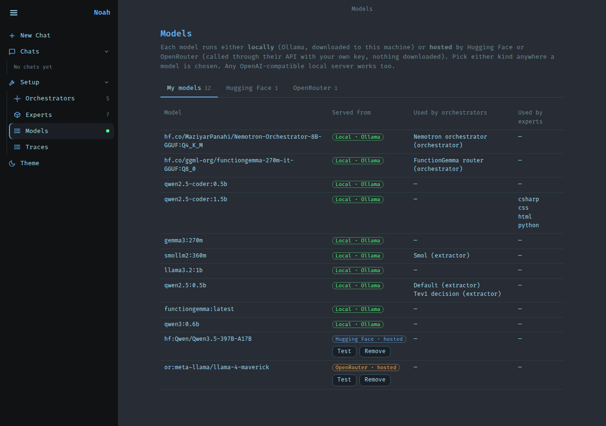
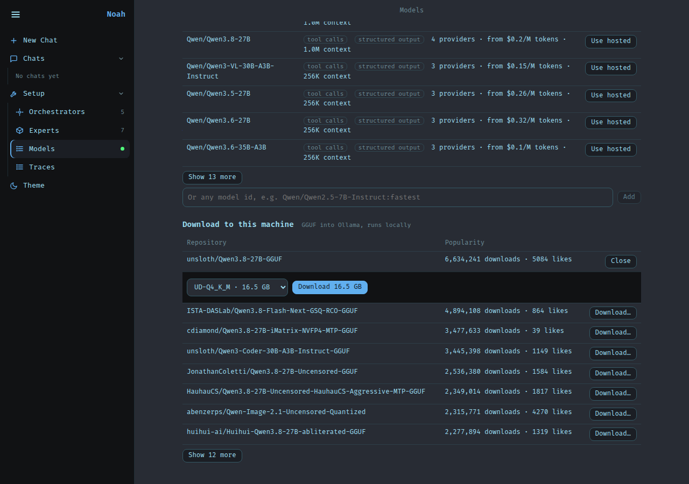
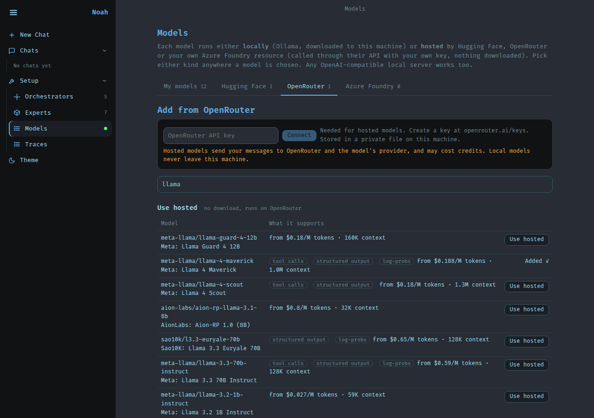
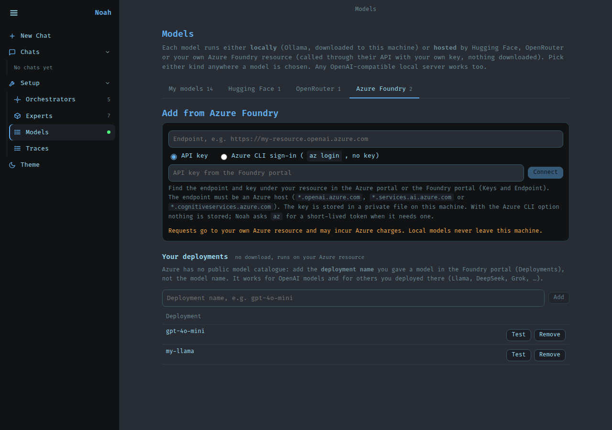
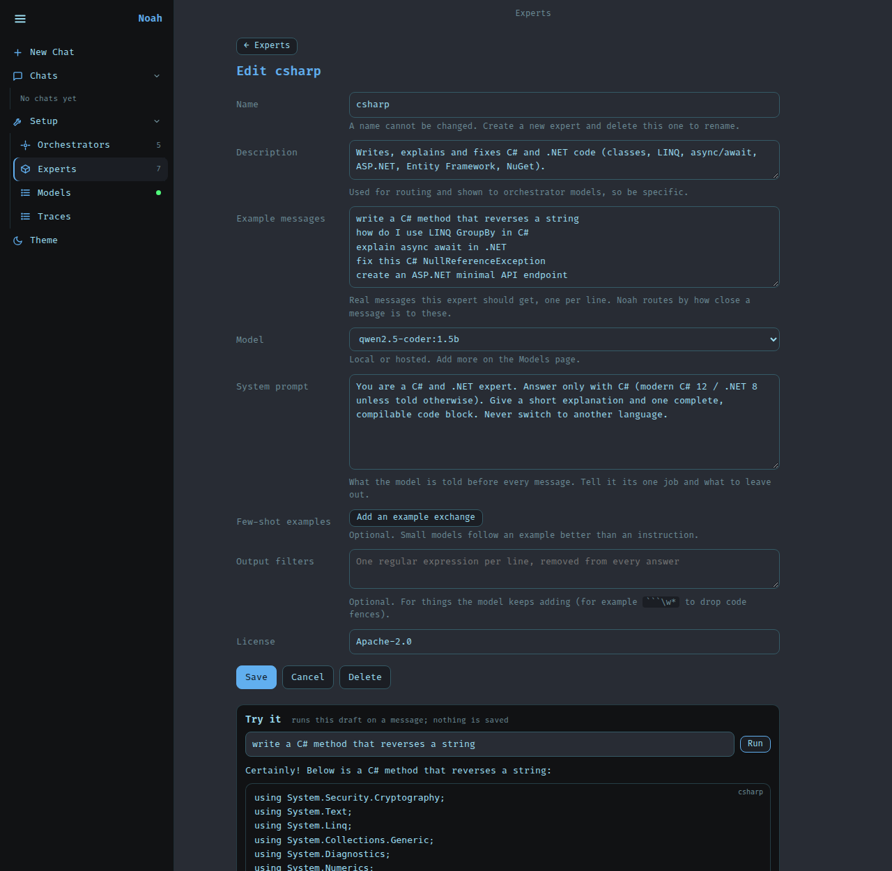

# Noah

[](https://github.com/sabitertan/noah/actions/workflows/pages.yml)
[](https://github.com/sabitertan/noah/actions/workflows/desktop.yml)
[](https://sabitertan.github.io/noah/)

Layered tiny-model orchestration. You pick a **decision engine** and an **orchestrator**; each job goes to a
small **expert** (a tiny model, a tool, or both). Every decision is traced, so you can later fine-tune your own.
Models can run locally (Ollama), hosted by Hugging Face, OpenRouter or your own Azure Foundry resource, or inside the web page itself (WebLLM, on your GPU), chosen per model. There is a web UI, a desktop app and a CLI.

**Demo:** [sabitertan.github.io/noah](https://sabitertan.github.io/noah/) runs Noah entirely in your browser; connect your own [Ollama](https://ollama.com/download) for local models, or download a small model into the page (Models > WebLLM) and need nothing else.

```
message -> [decision engine] -> [orchestrator: Microsoft Agent Framework workflow] -> [expert(s)] -> answer
                                                                                         \-> trace (JSONL)
```

## Screenshots

Each message is routed to one tiny expert; open "routing decision" to see how every expert scored.


A generate expert (C#, Qwen2.5-Coder 1.5B) answers with code. Orchestrator profiles (decision engine + mode + extractor + model) are managed in the UI.

Files expert: open a file right in the chat, or get download / open-with-app options.


| Code expert | Orchestrator profiles |
|---|---|
|  |  |

Models page, tab **My models**: every model is labelled by where it runs: local (Ollama), hosted by Hugging Face, OpenRouter or Azure Foundry, or in this browser (WebLLM). Each provider has its own tab.



Hugging Face: use a hosted model (no download), or download a GGUF into Ollama after choosing its quantisation.



OpenRouter: search its catalogue, see what each model supports and costs, and use it hosted (OpenRouter has nothing to download).



Azure Foundry: connect your own Azure resource with an API key or your Azure CLI sign-in, then add the deployments you created there.



Regenerate them against a running server with `python scripts/readme_shots.py` (needs `pip install -e ".[dev]"` plus `playwright install chromium`, or `CHROMIUM=/path/to/chromium`).

## Using the web UI

| Page | What it does | URL |
|---|---|---|
| Chat | Ask anything; pick an orchestrator and Route / Fan-out / Build; open "routing decision" to see every expert's score; file results open in place | `#/chat`, `#/chat/<id>` |
| Orchestrators | Cards for saved profiles with an on/off switch each; the editor below changes a draft that the selected card shows live ("unsaved") until you Save | `#/orch` |
| Experts | Every expert with its examples and an on/off switch; select one for its settings or all its files in a code editor, with checks before saving and versions; **Add MCP server** turns an MCP server into an expert | `#/experts`, `#/experts/<name>` |
| Models | Tabs: **My models** (every model and where it runs), **Hugging Face** (hosted or GGUF download), **OpenRouter** and **Azure Foundry** (hosted), **WebLLM** (download a small model into the browser and try it) | `#/models`, `#/models/hf`, `#/models/or`, `#/models/az`, `#/models/web` |
| Traces | Every routing decision, the raw material for fine-tuning | `#/traces` |

**Build mode** (the Build toggle, or the Builder orchestrator): describe an app ("a habit tracker with streaks") and Noah
builds a working single-page prototype right in the chat. A planner model writes a short spec, then the experts that
declare `produces: html | css | js` in `expert.yaml` write the markup, the styles and the script, each seeing the markup so
ids line up (`noah/builder.py`). The result is one self-contained HTML file with no server or database: it runs in a
sandboxed frame that cannot reach Noah, and what it saves in `localStorage` is kept with the chat. "Start over" clears it.
From the CLI: `noah build "a todo list" -o todo.html`. A bigger planner model (set it on the Orchestrators page) plans
better than the default 1.5B one, and a **Builder model** there switches all three builder experts at once. When a build
used small models, the result says so and suggests bigger ones: open models first (Qwen2.5-Coder 14B/32B, Qwen3-Coder,
Devstral, gpt-oss in Ollama, or the same through Hugging Face / OpenRouter), then your own Claude or OpenAI API key.

**Claude and OpenAI** (Models > Claude, Models > OpenAI): bring your own API key from console.anthropic.com or
platform.openai.com. Claude goes through the official Anthropic SDK (`noah/anthropic_api.py`), OpenAI through its
chat-completions API. A Claude.ai (Pro/Max) or ChatGPT (Plus/Pro) subscription is not an API key and cannot be used:
API use is billed per token by each provider. Neither is available in the in-browser build.

The sidebar shows how many orchestrators and experts are enabled (for example `5/7`). The page is kept in the URL, so a
refresh, the back button and bookmarks all land where you were. Chats are stored in your browser. Light and dark themes
are under "Theme".

## Quick start (Docker or Podman)

```bash
make up            # builds the image, starts Ollama, pulls the tiny models, starts Noah
# open http://localhost:8765
```

`make` auto-detects Docker or Podman. First start downloads about 1.5 GB of models; later starts are instant.
Next time, `make up` again is all it takes (Ctrl+C or `make down` stops it). Only one Noah can use port 8765: stop the
containers before starting the server by hand (below), or give that one another `--port`.

| You use | Needs |
|---|---|
| Docker | Docker with the Compose plugin (`docker compose`) |
| Podman | Podman 4+ and a compose provider: `pip install podman-compose` or `docker-compose` |

Without `make`:

```bash
docker compose up --build                       # Docker
PODMAN_USERNS=keep-id podman compose up --build # Podman (rootless: keep-id makes bind mounts writable)
```

NVIDIA GPU for Ollama: `make up GPU=1` (Podman also needs the CDI spec: `nvidia-ctk cdi generate`).

Windows (Podman Desktop / `podman machine`): there is no `make`, so use `podman compose up --build`. Run
`podman machine start` first. The WSL machine is rootful, so leave out `PODMAN_USERNS=keep-id`. If the build fails at
`pip install` with "Network is unreachable", or models time out on "pulling manifest", the machine's container
networking is broken. Try `podman machine stop` then `podman machine start`. If that doesn't help, build with
`podman build --network=host -t noah_noah .` and run both containers with `--network=host` (Noah with
`-e NOAH_LLM_URL=http://localhost:11434`).

Code, `experts/`, `data/` and `traces/` are bind-mounted, so edits reload live and traces survive restarts.
Ollama is not published to the host, so a host Ollama on port 11434 keeps working.

Other targets: `make test` (tests inside the image), `make logs`, `make shell`, `make down`,
`make pull-models M=qwen2.5-coder:3b`. Change the default models with `NOAH_MODELS="a b" make up`.

## Desktop app (Electron)

The desktop app is an extra shell around the same server and web UI. The browser UI (`make up`, `uvicorn`) is unchanged
and stays fully supported. The shell starts the server on a random loopback port with a per-launch secret (HttpOnly
cookie + Host check, so other web pages can't call it), shows the UI in a locked-down window, and stops the server on exit.

```bash
cd desktop && npm install
npm start                          # dev: uses ../.venv (or NOAH_PYTHON); needs the Python deps installed
python ../desktop/build_sidecar.py # freeze the server with PyInstaller (run in the project venv, ~170 MB)
npm run dist                       # installer in desktop/dist/ (AppImage on Linux, NSIS .exe on Windows, .dmg on macOS)
```

- PyInstaller and Electron don't cross-compile. `.github/workflows/desktop.yml` builds all three OSes on real runners
  (Actions tab > "Desktop builds" > Run workflow); download the installers from the run's Artifacts.
- Installed apps keep editable experts, profiles, traces and models in the OS user-data folder
  (Linux: `~/.config/noah-desktop`, Windows: `%APPDATA%\noah-desktop`), seeded on first run. The first embedding-engine use downloads about 70 MB.
- Builds are unsigned: expect a Windows SmartScreen or macOS Gatekeeper warning.
- Linux on Wayland + NVIDIA: Electron's native Wayland path crashed here, so Linux starts in X11 mode. Opt out with
  `NOAH_OZONE_PLATFORM=wayland`.
- Ollama is not bundled. The app tells you if it can't find it on port 11434.
- Windows: run the build from the project venv (`.venv\Scripts\activate`, then `pip install -e . pyinstaller`).
  PyInstaller warns that it can't collect `onnxruntime.quantization`; this is harmless. VS Code's terminal sets
  `ELECTRON_RUN_AS_NODE=1`, so starting `dist\win-unpacked\Noah.exe` from it fails with "bad option". Use
  `npm start` (it clears the variable), launch the app from Explorer, or run `Remove-Item Env:ELECTRON_RUN_AS_NODE` first.

With containers, `make dev` adds `compose.dev.yaml`: it mounts `noah/` and `experts/`, reloads the server on every Python/YAML change, and runs the Vite dev server for the UI (see "Web UI development" below).

## In the browser (static site, no server)

A second build target runs all of Noah inside the web page, so it can be published as a static site (GitHub Pages) and
people use it without installing Noah. The Python is the same: [Pyodide](https://pyodide.org) (CPython compiled to
WebAssembly) runs the FastAPI app in a Web Worker, and the page's `/api/...` requests go to it instead of the network
(`frontend/src/wasm/`, `noah/wasm.py`). Each visitor's experts, versions and settings stay in their own browser (IndexedDB).

```bash
cd frontend
npm run dev:wasm      # http://localhost:5174, reload the page after changing Python
npm run build:wasm    # the static site in site/ (with noah-py.zip: noah/ and experts/)
```

`.github/workflows/pages.yml` publishes `site/` on every push to `main` (enable once: Settings > Pages > Source: GitHub
Actions). The first visit downloads about 15 MB (Python and its packages, from the jsDelivr CDN), then it is cached; Python
starts in about 5 s.

**Models run in Ollama on the visitor's computer, or in the page itself.** For Ollama, the page walks them through it
(Models page): install Ollama, let the page use it, pull the models, press Connect. The address is a setting (default
`http://localhost:11434`). Without Ollama, a small model can be downloaded into the browser on the **WebLLM** tab and used
like any other ([below](#models-in-the-browser-webllm)).

- Ollama only answers web pages it trusts, so the visitor sets `OLLAMA_ORIGINS` to the site's address (for example
  `https://<user>.github.io`) and restarts Ollama. Pages on localhost need nothing.
- The browser may ask whether the site may use apps and services on the device; they choose Allow.
- Hosted models (Hugging Face, OpenRouter, Azure) are called straight from the browser with the visitor's own key, so they
  work as far as each provider allows calls from web pages (CORS).

What is different from the server: the embedding decision engine needs the ONNX runtime, which has no WebAssembly build
here, so the Default orchestrator routes by keywords. The `files` and `image` experts need programs on the computer (a files
folder, an image server) and start switched off. The expert check loads a draft in the page itself (there are no processes),
and Python can be edited freely: it only ever runs in the visitor's own tab.

### Models in the browser (WebLLM)

The **WebLLM** tab on the Models page downloads a small model from [WebLLM](https://github.com/mlc-ai/web-llm)'s catalogue
(Qwen2.5 0.5B/1.5B, Qwen2.5-Coder 1.5B, Qwen3 0.6B, Llama 3.2 1B, Gemma 3 1B, SmolLM2, …; **Show all** lists every one, smallest
first, with the GPU memory it needs) into the browser's cache and runs it on the GPU with WebGPU, in a worker so the page stays
responsive. Press **Download** once (a few hundred MB to about 1 GB per model), then **Load** on later visits; a **Try** box below
chats with the loaded model and shows tokens per second. Nothing is sent anywhere: no key, no Ollama, no server.

In the browser build, every downloaded model also appears in every model dropdown as `web:<model id>` (group "In this browser
(WebLLM)"), so orchestrators, the argument extractor and generate experts can use it:

- Noah's Python waits for the page's answer with Pyodide's `run_sync`, which needs WebAssembly JSPI: a recent Chrome or Edge.
  Elsewhere the tab says so and models can still be tried there.
- WebLLM only has tool calling for a few 8B models, so for every model Noah emulates it: the answer is constrained to JSON that
  matches the tools' schemas and turned back into tool calls (`frontend/src/lib/webllm-openai.js`). `llm_tools` and the extractor
  work on any of them.
- `llm_choice` gets at most 5 token log-probabilities (the engine asks for 20), so with many experts the less likely ones score 0.
- One model is on the GPU at a time; the first call after switching loads it (a few seconds, from the cache, never a download).
  Calling a model that is not downloaded says so instead of starting a download.
- The server, Docker and desktop builds show the tab for trying models only: their Python cannot reach the browser's GPU, and a
  `web:` model there fails with an error that says so.

## Without containers

```bash
python3 -m venv .venv && . .venv/bin/activate    # Windows: python -m venv .venv; .venv\Scripts\activate
pip install -e ".[dev]"
ollama serve &                                   # any OpenAI-compatible server works
ollama pull qwen2.5:0.5b && ollama pull qwen2.5-coder:1.5b
(cd frontend && npm install && npm run build)     # build the web UI once (Node 20+); the server serves noah/web/dist
uvicorn noah.server:app --port 8765              # NOAH_LLM_URL=http://host:port to point elsewhere
# while developing, reload on any Python/YAML change:
uvicorn noah.server:app --port 8765 --reload --reload-include "*.yaml"
pytest                                           # Python tests
python scripts/ui_check.py                       # drives the real web UI in Chromium against a stubbed Ollama / Hugging Face / OpenRouter / Azure (needs the UI built and playwright)
python -m noah.cli ask "calculate 15% of 240" --engine embedding
```

**Starting it again later** (setup done once): two terminals, from the project folder.

```bash
ollama serve                                       # terminal 1 (skip if Ollama already runs as a service)
. .venv/bin/activate && uvicorn noah.server:app --port 8765   # terminal 2, then open http://localhost:8765
scripts/image_server.sh qwen-turbo                 # optional terminal 3: the image expert's server (see "Image expert")
```

- `ollama: command not found`: Ollama is installed somewhere not on your PATH (for example a user-local
  `~/tools/ollama/bin/ollama`). Run it by its full path, or add its folder to PATH in `~/.profile`.
- `uvicorn: command not found`: the venv is not active (`. .venv/bin/activate`), or run `.venv/bin/uvicorn` directly.
- `address already in use`: something already serves port 8765, usually the containers from `make up` (`make down`).
- The page says the UI is not built: run `make ui-build` once (and after pulling UI changes).

### Web UI development (Vue + Vite, hot reload)

The UI is a Vue 3 app in `frontend/` (single-file components in `src/components/`, all shared state in `src/store.js`).
Vite serves it with hot module reload and proxies `/api` to the Noah server:

```bash
make dev                                # containers: API with reload + Vite, UI at http://localhost:5173
make dev-host                           # no containers (Linux/macOS): both on the host, same URLs
# or by hand, in two terminals (Windows too):
uvicorn noah.server:app --port 8765 --reload --reload-include "*.yaml"    # the API
cd frontend && npm install && npm run dev                                 # Vite: http://localhost:5173
```

Work at **http://localhost:5173** (Vite). Port 8765 serves the last production build, so it will not show your edits.

Edit a `.vue` file or `app.css` and the page updates in place without losing what you typed or the page you are on.
`make ui-build` (or `cd frontend && npm run build`) writes the production UI to `noah/web/dist`, which the server, the
Docker image (built in a Node stage, no Node at runtime) and the desktop app (`build_sidecar.py` runs it) all serve.
`noah/web/dist` is not committed, so a source checkout needs that one build, or the server shows a page saying so.
Another API port: `NOAH_API=http://127.0.0.1:9000 npm run dev`.

### Type checking (Pylance / pyright, strict)

The Python code (`noah/`, `experts/`, `tests/`, `scripts/`, the desktop sidecar) is kept at zero errors under pyright's
**strict** mode, which is what Pylance in VS Code runs. The settings live in `pyproject.toml` (`[tool.pyright]`), so
Pylance and the command line check the same files with the same rules:

```bash
pip install -e ".[dev]"     # includes pyright
pyright                     # from the activated .venv: expect "0 errors"
```

In VS Code, Pylance only finds the installed packages (FastAPI, httpx, pydantic, ...) when it uses the project's
`.venv` as its interpreter. Without it, imports are unresolved and strict mode reports "partially unknown" types
everywhere. Pick the interpreter with **Python: Select Interpreter** → `.venv`, or put this in `.vscode/settings.json`
(the `.vscode/` folder is git-ignored, so each developer keeps their own):

```json
{
  "python.defaultInterpreterPath": "${workspaceFolder}/.venv/bin/python"
}
```

Then run **Developer: Reload Window**.
Strict mode comes from `pyproject.toml`, so no `python.analysis.typeCheckingMode` setting is needed.

## Slots

| Slot | Choices today | Add your own |
|---|---|---|
| Decision engine | `keyword`, `embedding`, `llm_tools`, `llm_choice`, `laya` (optional) | implement `DecisionEngine` in `noah/engines/` |
| Orchestrator | `route` (best expert), `fanout` (several) | `noah/orchestrator.py` |
| Argument extractor | `rule`, `openai_compat` (any small model, schema-constrained JSON) | `noah/extractors/` |

Orchestrator profiles (a saved combination of the above) are created in the UI and stored in `data/profiles.json`.
Each profile has an enable/disable switch (like experts). A disabled orchestrator is dimmed, hidden from the chat
picker, and refused by the server (`/api/ask` with its `profile` name returns 409). If you switch off the active one,
Noah falls back to the first enabled one, and the last enabled orchestrator can't be switched off. Toggle via the UI or
`PUT /api/profiles/<name>` with `{"enabled": false}`.

## LLM orchestrators (Nemotron, FunctionGemma)

Besides score-based engines (`keyword`, `embedding`), the `llm_tools` engine hands the experts to a tool-calling
model as tools. The model picks the expert **and** its arguments in one call (with an explicit "none" tool so it can
decline), so no separate extractor model runs. Two example profiles ship next to `Default`:

```bash
ollama pull hf.co/MaziyarPanahi/Nemotron-Orchestrator-8B-GGUF:Q4_K_M   # 5 GB
ollama pull hf.co/ggml-org/functiongemma-270m-it-GGUF:Q8_0             # 300 MB
```

Measured on this repo's 28 labelled messages + 4 off-topic ones (`scripts/bench_orchestrators.py`), GTX 1070 8 GB:

| Orchestrator | Routes correctly | Declines off-topic | Time per decision |
|---|---|---|---|
| `embedding` (Default, threshold 0.63) | 28/28 | 4/4 | ~5 ms |
| Nemotron-Orchestrator-8B Q4_K_M | 19/28 | 4/4 | median 9 s (about 50 s on first load) |
| FunctionGemma 270M Q8_0 | 9/28 | 3/4 | median 0.6 s |

Read this as: the zero-shot LLM orchestrators are examples, not recommendations. Nemotron picks arguments well but
often answers directly instead of calling an expert, and is slow on a small GPU. FunctionGemma is meant to be
fine-tuned (the traces are the data for that). The embedding engine wins on this small, easy test set, but its
off-topic margin is thin (0.61 vs 0.65), so re-tune the threshold when you add experts.

## Decision models (Tev1, Laya)

Decision models answer one question about a state: here, "which tool should handle this request?", with the
experts plus `none` as options. They only pick the expert; the profile's extractor then fills the arguments.

- `llm_choice`: letter-choice models served by Ollama, such as Together AI's
  [Tev1](https://huggingface.co/togethercomputer/Tev1-0.8B-experimental). Options are sent as `{state, question,
  options}` JSON, and each expert's score is its probability from the answer token's logprobs. Each option includes
  its expert's first three manifest examples. With descriptions only, Tev1 routed 24/28.
  `ollama pull hf.co/DreamBlooms/Tev1-0.8B-experimental-GGUF:Q8_0` (800 MB), then use the "Tev1 decision" profile.
- `laya`: [Laya](https://huggingface.co/convaiinnovations/laya), a non-generative classifier that returns calibrated
  probabilities. It needs torch + transformers, so it's an optional extra: `pip install -e ".[laya]"`. It isn't in
  the container image or the desktop build. The engine and its "Laya decision" profile show up only when it's
  installed. The checkpoint (`auto`, `english`, `multilingual`) is the profile's orchestrator model; the first
  use downloads it (about 1.7 GB).

Same benchmark (`python scripts/bench_orchestrators.py llm_choice:<model> laya:english`), CPU only:

| Orchestrator | Routes correctly | Declines off-topic | Time per decision |
|---|---|---|---|
| Tev1-0.8B Q8_0 (`llm_choice`, threshold 0.5) | 28/28 | 4/4 | median 0.4 s |
| Laya English (`laya`, threshold 0.1) | 20/28 | 4/4 | median 0.45 s |

Zero-shot Laya usually ranks the right expert first (24/28) but puts most of the probability on `none`, which is why
its threshold is low. Adding examples to its options made it worse (8/28): Laya's options share a fixed token budget.
Laya is meant to be fine-tuned, and Noah's traces can serve as the training data.
Check each model's license before use: a third-party listing says Nemotron-Orchestrator-8B is research-only, and
FunctionGemma is under the Gemma terms.

## Hosted and local models (Hugging Face, OpenRouter, Azure Foundry, Ollama, WebLLM)

Every place that takes a model (orchestrator model, tiny argument model, generate experts) accepts any kind, and
the **Models** page shows which is which ("Local · Ollama", "Hugging Face · hosted", "OpenRouter · hosted", "Azure Foundry · hosted" or "This browser · WebLLM"):

| | Where it runs | Needs | Name |
|---|---|---|---|
| **Local** | Ollama on this machine | a download (GGUF) | `qwen2.5:0.5b`, `hf.co/unsloth/Qwen3-4B-GGUF:Q4_K_M` |
| **Hugging Face hosted** | Hugging Face Inference Providers, through their API. Nothing is downloaded. | a token | `hf:Qwen/Qwen2.5-7B-Instruct` |
| **OpenRouter hosted** | OpenRouter, through its API (it has nothing to download). | an API key | `or:meta-llama/llama-3.3-70b-instruct:free` |
| **Azure Foundry hosted** | A deployment on your own Azure resource, through its OpenAI-compatible v1 route. | an endpoint and an API key or `az login` | `az:my-gpt-4o-mini` (your deployment name) |
| **In this browser** | The visitor's GPU, inside the page ([WebLLM](#models-in-the-browser-webllm)). Browser build only. | a download into the browser, WebGPU | `web:Qwen2.5-0.5B-Instruct-q4f16_1-MLC` |

On **Models**, each provider has its own tab. Hugging Face and OpenRouter: paste your key, search, and press **Use hosted**.
The model then appears in every model dropdown (grouped by where it runs) and gets a **Test** button. Searching shows what
each model supports (tool calls, structured output, log-probs), its price per million tokens and its context size. For
Hugging Face you can instead press **Download…**, pick a quantisation (sizes shown) and watch Ollama pull it; it then
becomes a local model.

**Azure Foundry** has no public catalogue, because the models are the deployments you created. On its tab, enter your
resource endpoint (`https://<resource>.openai.azure.com` or `https://<resource>.services.ai.azure.com`), choose how to sign in, and
add each **deployment name** (the name you gave it in the Foundry portal, not the model name). It works for OpenAI models and for
others you deployed there (Llama, DeepSeek, Grok, …). Sign in with an **API key** (stored in a private file) or with your
**Azure CLI login** (`az login`; keyless through Microsoft Entra ID, so no key is stored and Noah asks `az` for a short-lived token
when needed; your identity needs a role such as Cognitive Services OpenAI User on the resource). Noah only sends the key to hosts
that look like Azure endpoints (`*.openai.azure.com`, `*.services.ai.azure.com`, `*.cognitiveservices.azure.com`, and the `.us` / `.cn`
clouds), so a mistyped URL cannot leak it. Newer reasoning deployments that reject `max_tokens` or a custom temperature are retried
with the parameters they accept.

- **Keys.** Hugging Face: a token from huggingface.co/settings/tokens with the "Make calls to Inference Providers" permission. OpenRouter: a key from openrouter.ai/keys. Azure: the key under your resource's "Keys and Endpoint". Paste it on the Models page, or set `HF_TOKEN`, `OPENROUTER_API_KEY`, or `AZURE_FOUNDRY_ENDPOINT` + `AZURE_FOUNDRY_API_KEY` (compose passes them through). A pasted key is stored in `data/hf_token`, `data/openrouter_key` or `data/azure_key` (owner-only, git-ignored) and is never sent back to the browser. Each provider only ever receives its own key.
- **Any id works by hand**, including suffixes such as `Qwen/Qwen2.5-7B-Instruct:fastest` (Hugging Face) or `meta-llama/llama-3.3-70b-instruct:free` / `:nitro` (OpenRouter).
- **Privacy and cost.** Hosted models send your messages (and the expert list, for orchestrators) to the provider and the model host, and may cost credits. Local models never leave the machine. The UI says so next to each key box.
- **Pick by capability.** Orchestrators (`llm_tools`) need **tool calls**; the argument extractor uses structured output and falls back to tool calls. The `llm_choice` decision engine reads token log-probabilities, so choose a model marked **log-probs** (or a local one).
- **Clear errors.** A bad key, no credits, a rate limit, a missing deployment or a model the provider does not serve is explained in plain words instead of silently falling back to the rule extractor.

## Files expert

The `files` expert searches `NOAH_FILES_DIR` (default `data/files`; the desktop app uses its own folder) and opens
the best match straight away:

| Type | Preview |
|---|---|
| `.txt`, `.log`, `.json`, `.yaml` | text |
| `.md` | text with headings, bold and code |
| `.csv`, `.tsv` | table (first 50 rows, 20 columns) |
| `.pdf` | extracted text (first 5 pages) |

Anything else (xlsx, docx, images, a scanned or broken PDF) says so and offers **Download** or **Open with app**.
When several files match, you get a list with an **Open** button on each.

- **Open with app** hands the file to the OS default application, so it only works on the computer running Noah
  (the desktop app, or the web UI opened locally) and only for documents, images and media. Scripts and executables are
  never launched. From a phone or another PC you get **Download**.
- Access is confined to the files folder: `..`, absolute paths and symlinks that leave it are rejected, downloads are
  sent as attachments, and file contents are never written to traces.
- Search matches file names first, then the text of small text files. Extension-only and content-only matches are hidden
  when one file clearly wins.
- Keep an expert's `examples` file-specific. Generic phrases such as "open my ..." or "show me ..." also match small
  talk and pushed off-topic messages above the routing threshold (0.70 vs 0.57 once fixed).

## Image expert

The `image` expert draws a picture from a description ("draw a red fox in a snowy forest", "make a wide wallpaper of
mountains") and shows it in the chat. The picture is saved in the files folder under `generated/`, so it can also be
downloaded, opened with an app, or found again with the files expert.

It runs locally through [stable-diffusion.cpp](https://github.com/leejet/stable-diffusion.cpp)'s `sd-server`, which
runs GGUF image models on a small GPU by streaming weights from RAM. One script downloads everything and starts it:

```bash
scripts/image_server.sh             # Qwen-Image-2.1, unsloth GGUF Q4_K_M (~10 GB download)
scripts/image_server.sh qwen-turbo  # Qwen-Image-2.1-Turbo: the same model distilled to 8 steps (+4 GB if you have the above)
scripts/image_server.sh zimage      # Z-Image-Turbo, unsloth GGUF Q4_K_M (~8 GB download, 8 steps, Apache-2.0)
```

| Preset | Model | Text encoder | Steps | License |
|---|---|---|---|---|
| `qwen` (default) | [unsloth/Qwen-Image-2.1-GGUF](https://huggingface.co/unsloth/Qwen-Image-2.1-GGUF) | Qwen3-VL-8B (UD-Q4_K_XL) | 20, CFG 6 | **Qwen Research License: non-commercial** |
| `qwen-turbo` | [unsloth/Qwen-Image-2.1-Turbo-GGUF](https://huggingface.co/unsloth/Qwen-Image-2.1-Turbo-GGUF) | Qwen3-VL-8B (UD-Q4_K_XL) | 8, CFG 1 | **Qwen Research License: non-commercial** |
| `zimage` | [unsloth/Z-Image-Turbo-GGUF](https://huggingface.co/unsloth/Z-Image-Turbo-GGUF) | Qwen3-4B (UD-Q4_K_XL) | 8, CFG 1 | Apache-2.0 |

Qwen-Image-2.1 (September 2026) is the top open-weight model on the Artificial Analysis text-to-image arena and the most
trending one on Hugging Face (October 2026), with strong text rendering and transparent (RGBA) output. Use Z-Image-Turbo
for commercial use.

Speed depends heavily on the GPU. On a GTX 1070 (8 GB, Vulkan, no fp16) the full `qwen` preset takes about 105 s per
step, so roughly 35 minutes per picture; `qwen-turbo` takes about 67 s per step (about 17 minutes for the first
1024×1024 picture, model loading included), so use it or `zimage` there. Requests wait up to an hour
(`NOAH_IMAGE_TIMEOUT`, in seconds).

- The server listens on `127.0.0.1:1234`; point Noah elsewhere with `NOAH_IMAGE_URL`. Any server with an OpenAI-style
  `POST /v1/images/generations` that returns `b64_json` works.
- **With `make up`** Noah runs in a container, which cannot reach the host's `127.0.0.1`. Start the image server with
  `NOAH_IMAGE_HOST=0.0.0.0 scripts/image_server.sh qwen-turbo`; compose already points Noah at
  `http://host.docker.internal:1234`. That also opens port 1234 to your network, so keep it behind a firewall.
- Files go to `~/.cache/noah/image` (`NOAH_IMAGE_DIR`). The script fetches sd.cpp's Linux Vulkan build (NVIDIA, AMD and
  Intel GPUs). On Windows or macOS, or for a CUDA build, set `SD_SERVER=/path/to/sd-server`. Extra flags go in `SD_ARGS`.
- Pictures are about one megapixel: square 1024×1024, landscape 1344×768 or portrait 768×1344, picked from words such
  as "wide", "wallpaper", "tall" or "portrait". The first request loads the models, so it is slower.
- Ollama's own image generation (`x/z-image-turbo`, `x/flux2-klein`) is still experimental and macOS-only, so it is not used here.

## Adding and editing experts

**In the web UI** (Experts page): press **New expert** to create a *generate* expert, or select any expert to edit it. You
give it a name, a description, example messages (Noah routes by how close a message is to them), a model (local or hosted),
and the system prompt that makes it do its one job; optionally few-shot example exchanges and output filters (regular
expressions removed from every answer). **Try it** runs your draft on a message before you save, and a saved expert is
used immediately, with no restart. It is written to `experts/<name>/expert.yaml`.



**Every file, in a code editor:** an expert's **Files** tab (where tool experts open) shows all of `experts/<name>/` in Monaco,
the editor of VS Code: `expert.yaml`, `tool.py` and any `.py`, `.yaml`, `.json`, `.md` or `.txt` you add. As you type,
YAML, the manifest and Python (syntax and [pyflakes](https://github.com/PyCQA/pyflakes)) are linted and marked in place.
**Check** and **Save** go further: they load *every* expert with your draft in place, in a separate process with a time
limit, the way the server would, and call the tool's `extract_rule` on its own examples. If that finds an error, nothing is
written. Warnings (an unused import, say) do not block a save. Ctrl/⌘+S saves.

**Versions:** each save, from either tab, is kept as a version under `data/expert_versions/<name>/`, starting with how the
files were before your first edit in Noah. **Compare** shows a version next to your draft; **Switch to** makes it the
current files again, through the same checks (it is recorded as a new version, so switching is never lost either).

- **Python is code the server runs**, so changing a `.py` file is only allowed from the computer running Noah: a loopback
  connection with a loopback host name (which also keeps other web sites and DNS-rebinding pages out). Elsewhere `.py`
  files are read-only and everything else stays editable. `NOAH_CODE_EDIT=1` allows code edits from any client (needed in
  Docker, where the browser is not on the container's loopback; then publish the port on `127.0.0.1` only, or anyone who
  can reach port 8765 can run code on it); `NOAH_CODE_EDIT=0` turns them off everywhere.
- **A broken expert** (say, a `tool.py` edited by hand) no longer stops the server: it is left out, and the Experts page
  says why, with a button that opens its files.
- **Tool experts** cannot be deleted from the UI, and new ones are still made by adding a folder with an `expert.yaml`
  and a `tool.py` (then edit them here).
- **Names** are fixed once created (a folder name and the tool name an orchestrator calls): create a new expert and delete the old one to rename.
- **Built-in experts are plain files in `experts/`**, so editing one in the UI changes that file (switch back to its first version, or use git).

**Or by hand:** create `experts/<name>/expert.yaml` (the app reloads when you save). Two kinds:

```yaml
# 1) tool expert: a small model extracts arguments, tool.py does the work
name: weather
description: Current weather for a city.
examples: [what's the weather in Paris]
parameters: {type: object, properties: {city: {type: string}}, required: [city]}
license: MIT
# + experts/weather/tool.py with  run(args) -> str  and optional  extract_rule(message) -> dict
```

```yaml
# 2) generate expert: its own small model answers directly
name: csharp
kind: generate
description: Writes, explains and fixes C# and .NET code.
examples: [write a C# method that reverses a string]
model: {backend: openai_compat, id: "qwen2.5-coder:1.5b"}
system: You are a C# expert. Answer only with C#.
shots: [{user: "...", assistant: "..."}]   # optional few-shot pair that pins the output style
strip: ["<style\\b.*?</style>"]            # optional regexes removed from the output (hard domain guard)
license: Apache-2.0
```

Good `description` and `examples` matter most: the decision engine routes on them.
Note each expert's model license (the manifest has a `license` field); some small models are non-commercial.

## MCP servers as experts

Any [MCP](https://modelcontextprotocol.io) server can be added as an expert: local and remote ones in the server and
desktop builds, remote ones in the browser build ([below](#mcp-in-the-browser-build)). On **Experts**, press
**Add MCP server** and paste the configuration you already use in Claude Desktop, VS Code or Cursor:

```json
{ "mcpServers": {
    "files": { "command": "npx", "args": ["-y", "@modelcontextprotocol/server-filesystem", "D:/notes"] },
    "github": { "url": "https://api.githubcopilot.com/mcp/", "headers": { "Authorization": "Bearer ${GITHUB_TOKEN}" } } } }
```

Each server becomes **one expert**, however many tools it has, so the expert list, the LLM orchestrators and `llm_choice`'s
option limit only ever see one entry per server. What happens to a message:

1. **Routing (Noah, unchanged).** The decision engine compares the message with every expert. An MCP expert brings every
   tool's description and examples, so "write a file todo.txt" reaches the filesystem server because it is close to
   `write_file`'s examples.
2. **Choosing the tool (the expert).** The message, without the expert's name ("github list my repos" → "list my repos"),
   is compared with each tool by the same embeddings (keyword overlap without them). When one tool is clearly closest, it
   wins; otherwise the expert's model names one of the six closest (structured output, which any model can do). The model
   then fills that tool's arguments, also with structured output.
3. **Grounding the arguments.** A value that is not in the message was made up by the model: an optional one is dropped,
   and a required one takes the expert's **default** if it has one (`path: D:/notes`, `owner: my-org`; set under
   **Default arguments** in its settings). A required one that is still a placeholder (`your_username`) is not sent: the
   reply says which argument to give.
4. **Asking first.** A tool not marked read-only by its server shows its arguments with **Run**, **Always allow** and
   **Cancel** in the chat, and runs only then. Read-only tools run right away.

Results: text goes into the reply; images and binary resources are saved under the files folder (`data/files/mcp/`) and
shown like any file.

When a server is added, the model you choose writes about five example requests per tool. They're kept in
`experts/<name>/tools.json`, which you can edit under **Files**. **Refresh tools** asks the server again: unchanged tools keep
their examples, and only new or changed ones get new ones; **Rewrite examples** has the model write them all again.
Examples that are no request a person would type (code like `list_releases owner/repo`, the prompt echoed back) are skipped
when routing; small models write many of those, so a 1.5B or larger model writes better ones. Without a model, tools are
matched by their descriptions only.

- **Embeddings shortlist, the model picks.** On GitHub's 46 tools and ten everyday requests, the closest tool by embeddings
  alone was right 4 to 6 times; qwen2.5 0.5B or qwen2.5-coder 1.5B naming one of the six closest, 10 times. For a model
  that is good at tool calling (large or hosted), tick **Use tool calling to pick and fill in one step**.
- **Secrets.** `${NAME}` in any value is read from the environment variable `NAME`, so tokens can stay out of `expert.yaml`.
  The UI shows a server's address or command, never its headers or env.
- **Permission.** A local server (`command`) is a program Noah starts, so adding one, or changing `server:` in the editor,
  needs the same permission as editing Python: by default only from the computer running Noah (`NOAH_CODE_EDIT`).
- **Connections** are kept open: a local server is started once and stopped after 10 idle minutes (`NOAH_MCP_IDLE`).
  Remote servers use Streamable HTTP; the older SSE transport is not supported.
- **Docker.** Local servers need their runtime (Node for `npx`, uv for `uvx`) inside the image.

### Signing in (OAuth)

A remote server that asks for sign-in is added right away, without tools, and shows **Sign in** (in the add results, in its
settings, and as a "sign in" tag on its card). Pressing it opens the server's sign-in page in a small window; when you come
back, Noah lists the tools (and writes their examples). Noah uses the MCP SDKs' OAuth: it discovers the server's
authorization server, registers itself there (dynamic client registration), signs in with PKCE, and refreshes tokens when
they run out, so you sign in once. **Sign out** deletes the tokens.

- **Where tokens live.** Server and desktop: `data/mcp_oauth/` (owner-only files), never sent to the browser. Browser build:
  that browser's storage.
- **Callback.** Server and desktop: `/api/mcp/oauth/callback` on Noah's own address (it works without the desktop app's
  launch token, protected by the sign-in's one-time state). Browser build: `oauth-callback.html` next to the page.
- **Never mid-chat.** A server that needs signing in while Noah answers says so ("press Sign in") instead of opening a window.
- **A token by hand wins.** With an `Authorization` header in the configuration, Noah sends that and does not sign in.

### MCP in the browser build

Noah's Python runs in a worker with no sockets or threads there, so the page is the MCP client: the official TypeScript SDK
(`frontend/src/lib/mcp.js`) connects, signs in and calls tools, and Python waits for it the way it waits for `web:` models
(Pyodide's `run_sync`, so a browser with WebAssembly JSPI: a recent Chrome or Edge).

- **Remote servers only** (`url`): a web page cannot start programs, so a `command` server says it needs the server or
  desktop version.
- **CORS.** The server must allow the page's origin (and expose `Mcp-Session-Id`); one that does not is reported as
  unreachable from the browser.
- `${NAME}` has no environment variables to read in a browser: put a token in `headers` directly (it stays in that browser),
  or let the server sign you in.

## Known limits

- Small models make small mistakes (unused imports, mislabelled algorithms). Verify generated code.
- Ambiguous prompts that span experts (HTML vs CSS) score nearly equal; use fan-out mode for those.
- Chat history lives in the browser (localStorage), not on the server.
- In-browser (WebLLM) models are small and pick or extract wrongly more often; prefer the 1.5B ones for real use.
- MCP servers with near-duplicate tools (`read_file` / `read_text_file`, `list_directory` / `list_allowed_directories`)
  are hard to tell apart by examples; edit their examples in `tools.json` to separate them. Small models may still fill
  two related options from one number ("first 2 lines" → `head` and `tail`); the server then says so.
